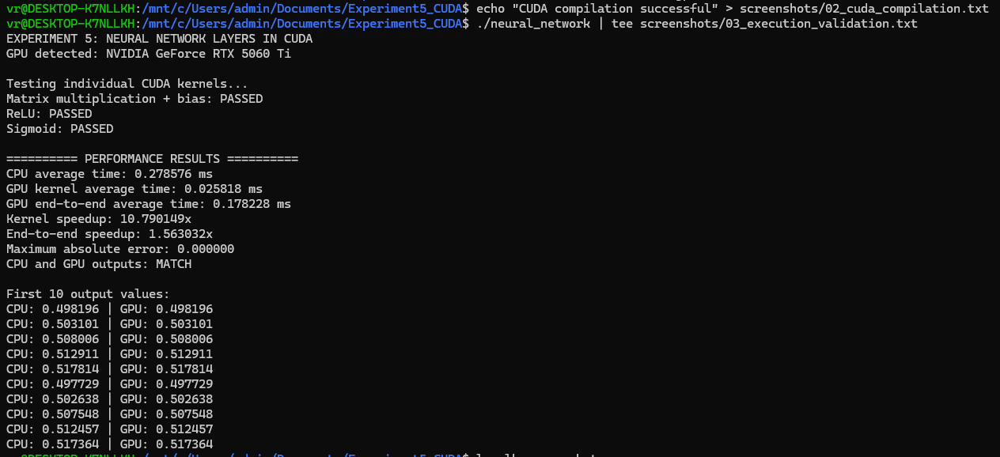

# Experiment 5: Neural Network Layers in CUDA

## 1. Aim

To implement and evaluate basic neural-network layers using custom CUDA kernels, including matrix multiplication with bias, ReLU activation, and sigmoid activation. The experiment executes the same forward pass on CPU and GPU, validates numerical correctness, measures execution time, and calculates GPU speedup.

## 2. Learning Outcomes

- Understand CUDA kernels, blocks, threads, and grid dimensions.
- Implement matrix multiplication with bias using CUDA.
- Implement ReLU and sigmoid activation kernels.
- Allocate and transfer data between host and device.
- Compare CPU and GPU execution results.
- Measure execution time and calculate GPU speedup.

## 3. Software and Hardware Requirements

### Hardware
- NVIDIA CUDA-capable GPU
- Windows 10/11 computer

### Software
- NVIDIA GPU Driver
- NVIDIA CUDA Toolkit
- CUDA Compiler (NVCC)
- Visual Studio 2022 Build Tools
- MSVC C++ Compiler

## 4. Theory

A neural network forward pass computes outputs by applying weighted sums and activation functions.

This experiment implements a two-layer feed-forward neural network.

**Layer 1:**
- Matrix multiplication with bias.
- ReLU activation.

**Layer 2:**
- Matrix multiplication with bias.
- Sigmoid activation.

The experiment uses custom CUDA kernels to execute these operations on the GPU and compares their results with the CPU implementation.

This experiment performs forward propagation only. It does not include training or backpropagation.

## 5. Network Configuration

| Parameter | Value |
|---|---:|
| BATCH | 256 |
| INPUT_SIZE | 128 |
| HIDDEN_SIZE | 64 |
| OUTPUT_SIZE | 10 |
| REPEATS | 20 |

### Tensor Dimensions

| Tensor | Shape |
|---|---|
| Input (X) | 256 × 128 |
| Weight 1 (W1) | 128 × 64 |
| Bias 1 (b1) | 64 elements |
| Hidden Activation | 256 × 64 |
| Weight 2 (W2) | 64 × 10 |
| Bias 2 (b2) | 10 elements |
| Final Output | 256 × 10 |

## 6. CUDA Kernels Implemented

### 6.1 Matrix Multiplication with Bias

Performs matrix multiplication between two matrices and adds a bias value to each output column. Each CUDA thread calculates one output matrix element.

### 6.2 ReLU Activation

ReLU converts negative values to zero while keeping positive values unchanged.

### 6.3 Sigmoid Activation

Sigmoid converts input values into a range between 0 and 1.

### 6.4 CPU and GPU Execution

The CPU implementation uses ordinary C++ functions and nested loops.

The GPU implementation allocates device memory, transfers input data, launches CUDA kernels, and copies the final output back to the host.

## 7. Procedure

### Step 1: Verify GPU Availability

```bash
nvidia-smi
```

### Step 2: Verify CUDA Compiler

```bash
nvcc --version
```

### Step 3: Create the Project Directory

```bash
mkdir "%USERPROFILE%\Documents\Experiment5_CUDA"
cd /d "%USERPROFILE%\Documents\Experiment5_CUDA"
```

### Step 4: Create the CUDA Source File

```bash
notepad neural_network.cu
```

Implement the CUDA kernels and CPU functions in the source file.

### Step 5: Compile the Program

Open the Visual Studio 2022 Developer Command Prompt and execute:

```bash
nvcc -O2 neural_network.cu -o neural_network.exe
```

### Step 6: Execute the Program

```bash
neural_network.exe
```

### Step 7: Validate Results

Verify that:
- Matrix multiplication with bias passes.
- ReLU activation passes.
- Sigmoid activation passes.
- CPU and GPU outputs match within the specified tolerance.

## 8. Performance Results

**GPU Used:** NVIDIA GeForce RTX 5060 Ti

The experiment was executed four times to evaluate CPU and GPU performance.

### Performance Observation Table

| Metric | Run 1 | Run 2 | Run 3 | Run 4 |
|---|---:|---:|---:|---:|
| CPU Average Time (ms) | 0.227644 | 0.223929 | 0.223802 | 0.223259 |
| GPU Kernel Time (ms) | 0.050862 | 0.059544 | 0.038038 | 0.028346 |
| GPU End-to-End Time (ms) | 0.263647 | 0.260239 | 0.226327 | 0.297853 |
| Kernel Speedup | 4.475683x | 3.760723x | 5.883593x | 7.876327x |
| End-to-End Speedup | 0.863441x | 0.860473x | 0.988845x | 0.749561x |

### Performance Analysis

- GPU kernel execution was faster than CPU execution in all four runs.
- The highest kernel speedup was 7.876327x in Run 4.
- GPU end-to-end execution included memory transfer overhead.
- End-to-end GPU execution was slower than CPU execution in all four runs.
- Execution times varied slightly between runs.

## 9. Validation Results

All three individual CUDA kernel tests passed successfully.

| Test | Result |
|---|---|
| Matrix Multiplication + Bias | PASSED |
| ReLU Activation | PASSED |
| Sigmoid Activation | PASSED |
| CPU and GPU Output Comparison | MATCH |
| Maximum Absolute Error | 0.000000 |

The CPU and GPU implementations produced matching numerical results within the specified tolerance.

## 10. Output Screenshot

The following screenshot shows the actual execution output of Experiment 5, including GPU detection, CUDA kernel validation, CPU and GPU performance measurements, and numerical correctness.



## 11. Conclusion

The experiment successfully implemented neural-network layers using custom CUDA kernels, including matrix multiplication with bias, ReLU activation, and sigmoid activation.

All three CUDA kernel validation tests passed successfully, and the CPU and GPU outputs matched with a maximum absolute error of 0.000000.

GPU kernel execution achieved speedups ranging from approximately 3.76x to 7.88x. However, end-to-end GPU execution was slower than CPU execution because of memory transfer and execution overhead.

Thus, the experiment demonstrates CUDA-based parallel processing for neural-network layers and highlights the importance of considering data transfer overhead when evaluating GPU performance.

## 12. Repository Structure

```text
pgc-05-/
│
├── README.md
│
├── screenshots/
│   └── output.png
│
└── results/
    └── performance_results.txt
```

